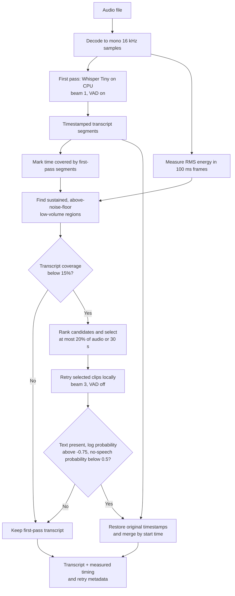

# Local Whisper Bridge

Local Whisper Bridge is a FastAPI proof of concept for comparing two transcription paths: OpenAI's hosted `whisper-1` API and an offline, CPU-based Whisper Tiny checkpoint. Its own optimization is **quiet-gap rescue**: after a fast first local decode, it spends a bounded amount of extra inference on low-volume parts of the audio that received little transcript coverage.

The project is a transcription lab, not a Wispr Flow integration. It does not run Wispr's proprietary model, modify Wispr Flow, or demonstrate that Whisper Tiny meets a phone or watch latency target. The browser records consecutive six-second files; each file is transcribed after that clip ends. A slow inference pass can fall behind recording.

## How the two paths work

| Mode in the browser | Processing | Network | What it demonstrates |
| --- | --- | --- | --- |
| **Offline with quiet-gap rescue** | Whisper Tiny on this computer's CPU, followed by selective local retries | None during transcription | The custom inference policy |
| **Offline baseline** | The same local model and first-pass settings, without retries | None during transcription | An A/B comparison against rescue |
| **OpenAI only** | Hosted `whisper-1` through `POST /openai/transcribe` | Required | A real cloud transcription call |
| **Automatic** | OpenAI first; local rescue if the browser receives a connection or timeout error (`502` or `504`) | Usually required; falls back locally | A narrow connectivity fallback, not a general quality router |

The server binds to `127.0.0.1`. An OpenAI API key stays in the server environment or the ignored `.env.local` file; the browser does not receive it. The offline model is downloaded explicitly by `prepare` and is loaded from disk thereafter. Offline transcription does not download a model or send audio to OpenAI.

## The local optimization

The diagram follows `LocalWhisperEngine.transcribe()` in [`local_whisper_bridge/local_engine.py`](local_whisper_bridge/local_engine.py). It shows **where extra compute is spent**: only candidates that survive the quiet-gap tests and fit the retry budget get a second decode.



The first pass uses `faster-whisper` with CTranslate2. It selects `int8` CPU compute **if supported**, otherwise `float32`; this is an existing runtime capability, not a quantization algorithm invented by this project. The first pass uses `beam_size=1` and `vad_filter=True` to avoid spending the same compute on every portion of a clip.

Quiet-gap rescue is the project's custom controller:

1. **Measure energy.** It splits decoded 16 kHz audio into 100 ms frames and calculates each frame's root-mean-square (RMS) amplitude. The 20th percentile, with a minimum floor, estimates background level. It selects frames above that floor but below an upper threshold, bridges a one-frame interruption, and requires at least 300 ms of candidate audio. Each candidate receives 250 ms of padding on both sides.
2. **Find what the first pass missed.** It compares each candidate's time span with the first-pass transcript segments. A candidate proceeds only when transcript coverage is under 15%. This is a timestamp heuristic; an uncovered region is not proof of speech.
3. **Spend a fixed retry budget.** It ranks candidates by duration and energy above the floor, rejects overlapping selections, and retries no more than the smaller of **20% of the recording** or **30 seconds**. Some eligible candidates may be skipped when the budget is exhausted.
4. **Decode differently and filter the result.** Each selected clip is decoded again with `beam_size=3`, `vad_filter=False`, `temperature=0`, and `condition_on_previous_text=False`. The engine accepts nonempty text only if the model reports `avg_logprob > -0.75` and `no_speech_prob < 0.5`. It translates accepted clip timestamps back to the original recording and sorts them with the first-pass segments.

The response includes `text`, timestamped `segments`, and `optimization` measurements: audio duration, duration retained after first-pass VAD, first-pass and total wall time, real-time factor (`total_seconds / audio_seconds`), retried spans, and the number of recovered segments. Set `rescue=false` to run the otherwise identical offline baseline. This policy may recover quiet speech, but energy and model confidence are imperfect: it can retry noise, miss soft speech, duplicate words, or hallucinate. The budget caps *audio duration retried*, not wall-clock latency or CPU use.

### Where this would fit in a local-first dictation architecture

For an application that already captures PCM, the policy would sit **after capture and before cloud ASR**. A local worker would consume the captured samples and return transcript segments to the application's normal text-output path. A cloud fallback would receive audio only when the local path cannot finish acceptably. The current FastAPI app illustrates the local inference and retry policy; it does **not** implement that integration or a production confidence-based cloud router. Sending every locally processed clip to cloud as well would retain cloud inference cost.

## Run it

From the project directory, on the prepared development computer:

```bash
source .venv/bin/activate
local-whisper-bridge serve
```

Open <http://127.0.0.1:8765/>. Upload an audio file or start the microphone, then choose a processing mode. The browser reports which provider returned a transcript and shows local optimization timings when applicable.

On a new computer, install and prepare the model once while online:

```bash
python -m pip install -e '.[test]'
local-whisper-bridge prepare
local-whisper-bridge serve
```

`prepare` downloads the Whisper Tiny checkpoint into `models/tiny` by default. Set `LWB_MODEL_DIR` before preparing and serving if you need another model-storage location. The offline inference route requires that prepared checkpoint; it does not silently fall back to OpenAI.

To enable the cloud mode, set `OPENAI_API_KEY` in the server environment or put `OPENAI_API_KEY=...` in an ignored `.env.local` in the directory where you start the server. OpenAI requests need internet access and may incur API charges. A live OpenAI call has not been verified for this project because no key is configured here.

### API and verification

- `GET /openai/status` reports whether a key is configured and the local checkpoint is ready.
- `POST /offline/transcribe` accepts a multipart `file`; use `?rescue=false` for the baseline.
- `POST /openai/transcribe` accepts a multipart `file` and calls OpenAI `whisper-1`.
- Both upload routes reject empty files, unsupported extensions, and files over 25 MiB. The offline route processes a temporary file and removes it afterward.

Run the tests with `python -m pytest -q`. They cover the gap planner's budget, a mocked second decode, separation of the offline route, and the OpenAI request handling. They do not establish accuracy or performance across devices.

## Evidence and limits

On the OpenAI Whisper repository's 11-second JFK sample, both local modes returned the expected sentence and rescue found no span to retry. In one constructed 18-second test, appending a three-second section at 3.5% amplitude caused the baseline to omit a quiet phrase; rescue retried 13.05–15.25 seconds and recovered “And so, my fellow Americans.” One warmed run took about 1.5 seconds end to end on this Mac. This is a demonstration case, **not** a measured word-error-rate improvement or a device-speed benchmark.

Before claiming a product benefit, test consented quiet speech, noisy rooms, multiple accents and languages, overlapping speakers, and silence. Report word error rate, false additions, median and tail latency, CPU load, memory, and power alongside baseline results. The Python prototype currently runs on a computer. iPhone, Android, and Apple Watch deployment would require a native capture and inference runtime, model packaging, and measurements on those devices.
